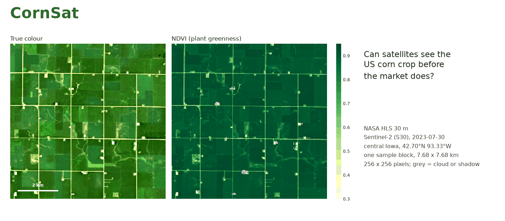
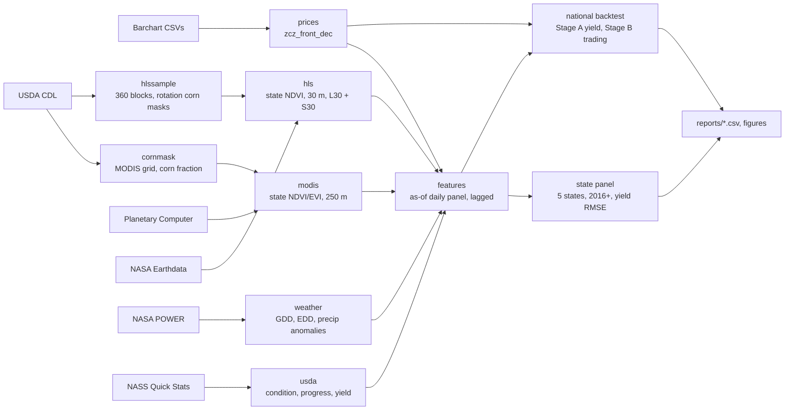
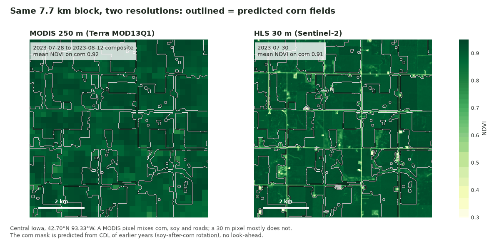
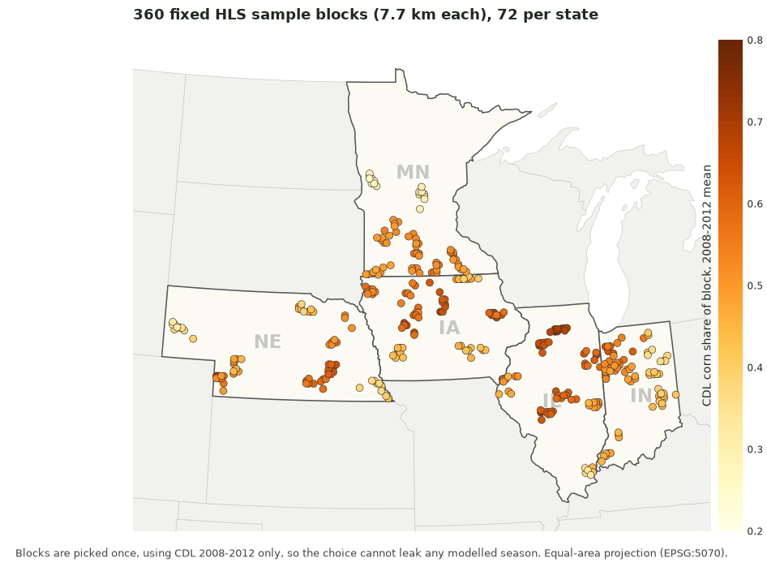
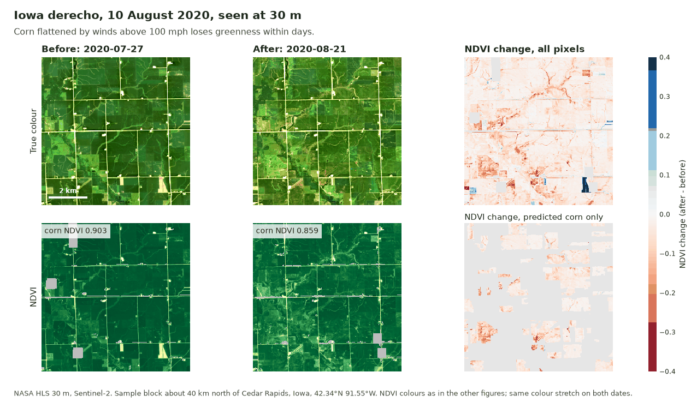
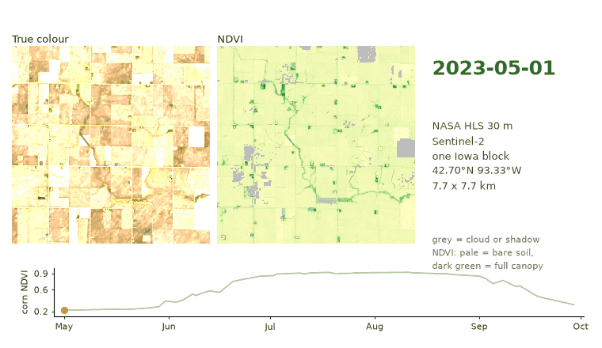
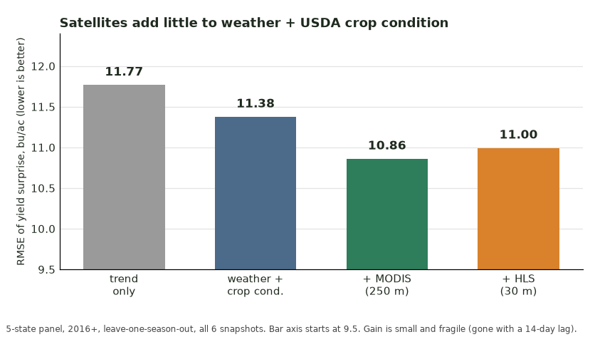
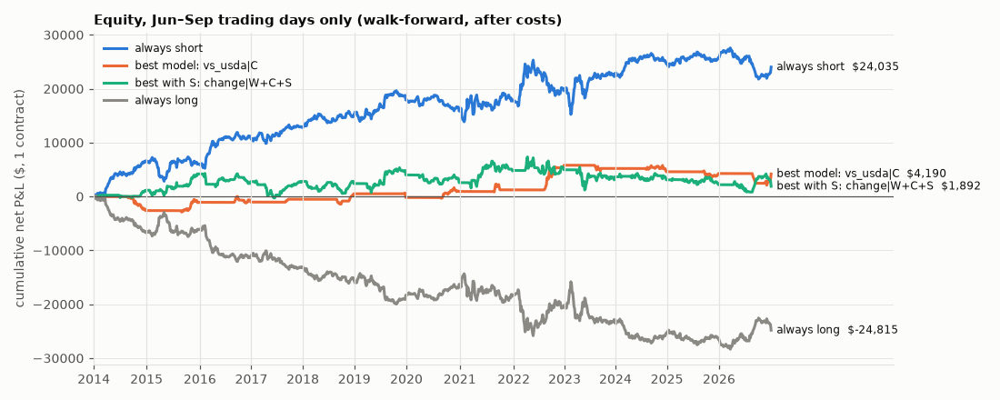

<p align="center"></p>

# CornSat

Does satellite crop health over the Corn Belt predict US corn yield surprises and
December corn futures (ZCZ), beyond what weather and USDA crop condition already tell us?

**Short answer: no.** Neither 250 m MODIS nor 30 m NASA HLS imagery adds a reliable edge.
2009-2026, walk-forward, after costs. See [Results at a glance](#results-at-a-glance) and
[`reports/phase8_results.md`](reports/phase8_results.md).

## How it works



## Imagery

All images are real data, rebuilt by [`scripts/make_readme_visuals.py`](scripts/make_readme_visuals.py).

**30 m versus 250 m.** The same 7.7 km block in central Iowa (Sentinel-2 HLS, 30 Jul 2023;
Terra MODIS composite 28 Jul to 12 Aug). Outlined: the corn mask predicted from earlier CDL
years. HLS tracks MODIS closely (state NDVI r = 0.968) and has a higher peak (0.886 vs 0.862)
because its pixels are purer corn.



**The sample.** 360 fixed 256 x 256 pixel blocks (72 per state), chosen once from CDL
2008-2012 so the choice cannot leak a modelled season.



**Derecho, 10 August 2020.** A block north of Cedar Rapids, Iowa, before and after the storm:
flattened corn shows up as lost greenness.



**One season.** NDVI of a single block, May to September 2023, cloud-free HLS scenes only.



## Results at a glance



*Phase 8, 5-state panel, 2016+, leave-one-season-out.* Yield RMSE goes from 11.38 (weather +
crop condition) to 10.86 with MODIS and 11.00 with HLS 30 m (bu/ac): a small, fragile gain over
W+C, no gain from 30 m over MODIS, gone with a 14-day publication lag, and not tradable
nationally. Details: [`reports/phase8_results.md`](reports/phase8_results.md).

*National backtest, Stage B, 2014-2026, after costs.* Always-short is the only strategy that
clears the bootstrap; no model strategy does, with or without satellite features.



## Goal and hypothesis

Corn prices react to news about the size of the US crop. The hypothesis was that vegetation
indices (NDVI/EVI) from MODIS, aggregated over corn pixels in five Corn Belt states, carry
yield information early enough, and independent enough from weather and USDA condition
ratings, to forecast the final yield surprise and to trade December corn (ZCZ) from June to
September.

Two stages test it:

- **Stage A, yield.** Predict the final national yield minus an OLS trend (the "surprise")
  from three feature groups: **W** weather, **C** USDA crop condition, **S** satellite, at 7
  snapshots from Jun 15 to Sep 15. Expanding walk-forward, 12 scored seasons (2014-2025).
- **Stage B, trading.** One ZCZ contract, weekly Jun-Sep, 2014-2026, after costs, with three
  signal rules (`level`, `change`, `vs_usda`) over each feature set, against always-short,
  always-long and flat benchmarks.

The analysis is exploratory, not pre-registered (see [Limitations](#limitations)).

## Data sources

| Source | What | Access |
|---|---|---|
| Barchart | ZCZ daily bars, one CSV per contract, 2009-2026 | files in `data/raw/` |
| MODIS MOD13Q1 / MYD13Q1 v061 | 250 m NDVI/EVI, 16-day composites, Terra + Aqua | Microsoft Planetary Computer (STAC) |
| USDA CDL | Cropland Data Layer, corn mask per state and year (2008-2025) | USDA download service |
| NASA HLS v2.0 (HLSL30 + HLSS30) | 30 m Landsat + Sentinel-2 surface reflectance and Fmask, 2013-2026, sampled in 360 blocks | NASA Earthdata (CMR + LP DAAC COGs), needs `EARTHDATA_TOKEN` |
| NASA POWER | daily Tmax/Tmin/precipitation at 35 corn points | NASA POWER API |
| USDA NASS Quick Stats | crop condition, progress, yield and forecasts | API, needs `NASS_API_KEY` |

States: IA, IL, NE, MN, IN. The US aggregate is weighted by state.

## Setup

Requires Python 3.12 and [uv](https://docs.astral.sh/uv/).

```bash
uv sync
cp .env.example .env     # then set NASS_API_KEY=... (free key from NASS Quick Stats)
                         # and EARTHDATA_TOKEN=... (NASA Earthdata "Generate Token", for HLS)
```

`.env` is never committed. The USDA step needs `NASS_API_KEY` and the HLS steps need
`EARTHDATA_TOKEN`; the rest runs without keys (without a token the HLS step is skipped).

## Running

```bash
uv run python scripts/build_all.py                  # whole pipeline
uv run python scripts/build_all.py --from features  # features + backtest only (about 30 s)
uv run python scripts/build_all.py --force          # rebuild the network steps too
uv run python scripts/build_hls_sample.py           # HLS blocks + predicted corn masks (CDL)
uv run python scripts/build_hls.py --pilot          # HLS ingest check: IA, 2024
uv run python scripts/build_hls.py                  # HLS ingest, 5 states x 2013-2026 (resumable)
uv run python scripts/run_state_panel.py            # 5-state panel (W, C, S, H feature sets)
uv run python scripts/make_readme_visuals.py        # rebuild docs/img (cached downloads)
uv run pytest -q                                    # test suite
```

`build_all.py` runs
`prices -> cornmask -> modis -> hls_sample -> hls -> weather -> usda -> features -> backtest`
and prints the final metrics table from `reports/stageB_summary.csv`. The expensive,
network-bound steps (cornmask, modis, weather, usda) are skipped when their outputs exist
unless `--force`; `--from STEP` starts at any step. A cold MODIS build is long (about 4.5
minutes per season), CDL downloads are large, and both are resumable. Each step also has its
own script in `scripts/` (`build_prices.py`, `build_cornmask.py`, `build_modis.py`,
`build_hls_sample.py`, `build_hls.py`, `build_weather.py`, `build_usda.py`,
`build_features.py`, `run_backtest.py`).

## Repository layout

```
src/cornsat/     library: prices, cornmask, modis, hls, hlssample, weather, usda, features, panel, model, backtest
scripts/         build_all.py (orchestrator) and one script per step
docs/img/        README images (made by scripts/make_readme_visuals.py)
notebooks/       00 ingest example, 01 prices, 02 NDVI EDA, 03 features, 04 backtest
reports/         phase6_design.md, phase6_results.md, phase8_results.md, stage*.csv, state_panel*.csv, figures/
tests/           pytest suite (no-look-ahead, truncation, model and backtest tests)
data/raw/        original downloads, read-only
data/interim/    caches (corn masks, MODIS per year, HLS blocks and scenes, NASS, weather)
data/processed/  analysis-ready parquet tables (prices, features, predictions, trades)
```

## Phase 6 results (national, MODIS)

Phase 6 detail and every number: [`reports/phase6_results.md`](reports/phase6_results.md);
figures in `reports/figures/`; walkthrough in `notebooks/04_backtest.ipynb`.

**Verdict: negative.** The satellite features add no measurable yield accuracy, and no model
strategy beats a plain always-short Jun-Sep after costs.

Stage A: walk-forward RMSE of the yield surprise, 12 seasons, mean over the 7 snapshots
(bu/ac):

| trend only | W | C | S | W+C | W+S | C+S | W+C+S | USDA forecast, Aug 15 / Sep 1 / Sep 15 |
|---|---|---|---|---|---|---|---|---|
| 6.4 | 8.56 | 6.73 | 7.41 | 6.98 | 8.08 | 7.56 | 7.43 | 4.2 / 4.2 / 3.6 (single-snapshot RMSE) |

- No feature set beats the trend-only forecast on average (best set C 6.7).
- Adding S to W+C makes the season-average error worse (7.1 to 7.6; S helps in 5 of 12
  seasons; p = 0.21 t-test, 0.38 Wilcoxon). The one snapshot where S looked helpful (Sep 15,
  6.6 to 5.6) is not significant after the audit fixes (p = 0.13 / 0.08) and comes after
  the better USDA September report.

Stage B: 1 ZCZ contract, Jun-Sep, 2014-2026, after costs (selected rows):

| strategy | net P&L ($) | Sharpe | seasons positive | P&L 95% CI |
|---|---|---|---|---|
| always short | +24,035 | 0.93 | 10 / 13 | 7,885 ... 40,873 |
| `vs_usda\|C` (best model, no satellite) | +4,190 | 0.35 | 7 / 13 | -6,355 ... 16,048 |
| `change\|W+C+S` (best with S) | +1,892 | 0.10 | 6 / 13 | -7,488 ... 12,118 |
| `level\|W+C+S` | -2,578 | -0.17 | 7 / 13 | -26,084 ... 17,775 |
| `vs_usda\|W+C+S` | -400 | -0.18 | 5 / 13 | -11,578 ... 13,303 |
| `change\|W+C` | -16,032 | -0.86 | 2 / 13 | -28,005 ... -4,525 |
| always long | -24,815 | -0.97 | 3 / 13 | -41,653 ... -8,665 |

- No model strategy has a P&L bootstrap interval that excludes zero on the positive side.
- Satellite vs none: W+C+S is far below always-short and not distinguishable from flat under
  any rule. The one comparison where S looks better, `change|W+C+S` vs `change|W+C`
  (+17,925), is a losing strategy (-16,032) against a flat one: S makes a losing signal
  roughly flat, it does not create a profitable one.
- Always-short is the only result that clears the season bootstrap (P(P&L <= 0) = 0.002) at
  a Bonferroni-style level. It is the known seasonal weather-premium decay, not something
  this project discovered, and 13 seasons is a short sample.

**Why the satellite arrives too late (2012).** 14-day EDD passed 20 on Jun 27 and the USDA
good/excellent rating was more than 10 points below normal by Jun 26; ZCZ12 was already
rallying in mid-June. US `ndvi_z` fell below -1 only on Aug 9, after a 14-day publication lag
and with 16-day composites; the price peaked on Aug 21.

## No-look-ahead safeguards

- **Availability lags.** Every value is used only from its `available_date`: MODIS
  composite end + 14 days, NASA POWER date + 3 days (`WEATHER_LAG_DAYS`), NASS reports from
  the day after the real release timestamp (Monday reports from Tuesday). The feature panel records
  `modis_asof`, `weather_asof` and `usda_asof`, and the build asserts each is on or before
  the row date.
- **Corn masks** use CDL years before the season only (no same-year or later crop map).
- **Truncation tests.** The test suite recomputes features on data cut at a date and checks
  that values up to that date do not change, so nothing later leaks into earlier rows.
- **Walk-forward.** Season Y is trained on seasons before Y only, with ridge alpha chosen
  by leave-one-out inside the training seasons. The trend target uses 1990..Y-1.
  Leave-one-season-out is reported only for comparison (it trains on future seasons and
  flatters the results).
- **Change rule.** The signal is the same fitted model scoring two rows dated on or before
  the rebalance date, not a comparison of two different refits.
- **Independent audit.** An independent audit found five issues (1-day weather lag instead
  of 3, change rule trading model churn, US aggregate composition, 2009-2011 forecast
  release dates, a partial last price bar). Each was fixed with a test that fails on the old
  code. The pre-audit headline `change|W` (+$10,882) became +$1,105.

## Limitations

- **Exploratory.** The design note was committed together with the results, so thresholds,
  feature sets and rules are not pre-registered; the S feature mix was also not specified in
  advance. About 18 strategies were tested; apply a Bonferroni-style correction (0.05/18).
- **Small sample.** 12 scored walk-forward seasons and 13 trading seasons; 2012 (-38 bu/ac)
  dominates early fits. Power is low: a gain of about 1 bu/ac RMSE cannot be ruled out.
- **Reprocessed MODIS (C6.1) and reanalysis weather.** Not the data as it was in real time;
  the lags only model timing. POWER is gridded reanalysis at 35 points.
- **HLS history is a reconstruction.** HLS 2016-2021 comes from the archive (Landsat 8 plus
  Sentinel-2 from 2016, thinner early on), reprocessed after the fact; only 2022+ is
  operational data. 360 blocks sample about 21,000 km2, not whole states.
- **2025 satellite gap** (MODIS NaN after Aug 10, 2025) and **2026 partial** (no final yield).
- **Final yields** are later NASS revisions (at most about 0.7 bu/ac off the January
  release). The 2009-2011 USDA release calendar was entered from memory and should be
  checked (it affects no reported number).
- **Trading assumptions.** One contract at the settlement close; no margin or interest;
  liquidity and limit-move days ignored.

## Possible next steps

- County-level analysis instead of five state aggregates.
- County-level HLS (more blocks) and a real-time HLS vintage test.
- Real-time (non-reprocessed) MODIS and weather vintages, to test the lag assumptions.
- Other markets, e.g. soybeans (ZSX).
- Predict the USDA August Crop Production surprise instead of the price.

## Credits

Imagery: NASA HLS v2.0 (LP DAAC) and USDA NASS Cropland Data Layer, both public domain;
MODIS MOD13Q1 via Microsoft Planetary Computer. Weather: NASA POWER. Yields and crop
condition: USDA NASS.
