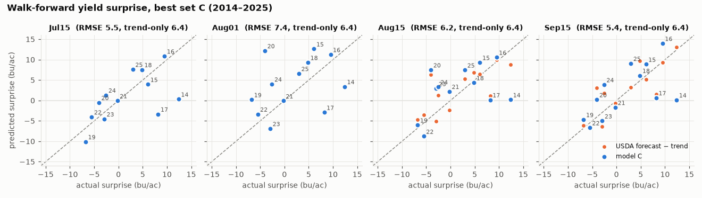
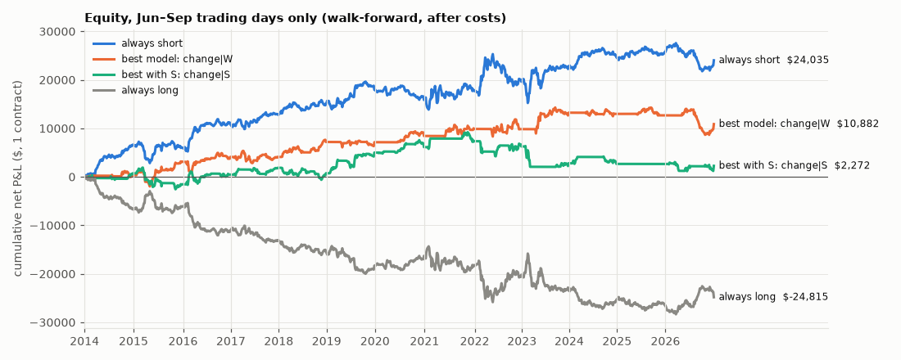
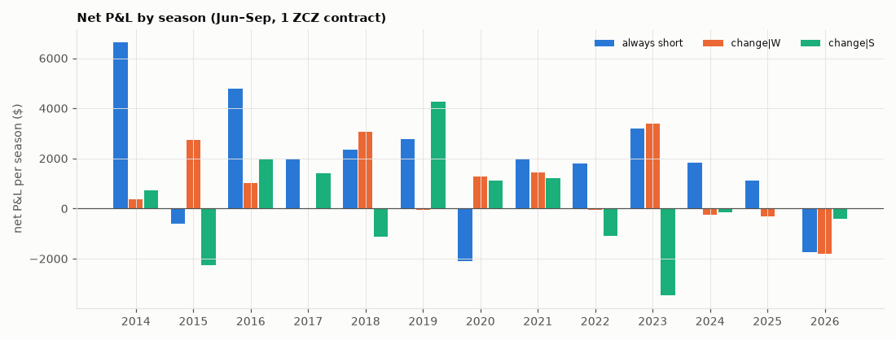
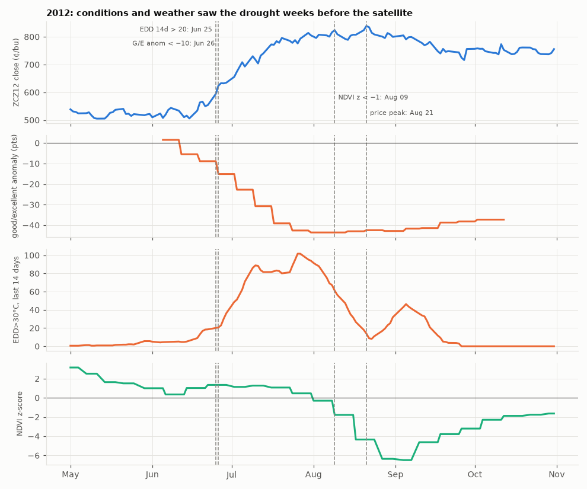

# Phase 6 results: yield-surprise model and ZCZ backtest

Design: `reports/phase6_design.md`, fixed before any fit. Reproduce with
`uv run python scripts/run_backtest.py`. Tables are in `reports/*.csv` and figures in
`reports/figures/`.

## Verdict

**Negative.** The satellite features add nothing that can be measured and traded here, and
nothing beats a plain always-short Jun–Sep after costs.

- **Stage A, yield.** On the honest walk-forward (12 scored seasons, 2014–2025), no feature set
  beats the trend-only forecast at most snapshots. The USDA forecast beats every model by a wide
  margin from mid-August. Adding S to W+C makes the season-average error *worse* (RMSE 7.7 vs 7.1;
  S helps in 6 of 12 seasons; p = 0.21 t-test, 0.57 Wilcoxon). The one snapshot where S helps
  (Sep 15) comes after the USDA September report, which is better still.
- **Stage B, trading.** Of 15 model strategies, the best is `change|W` (+$10.9k), which uses no
  satellite data. It is well below always-short (+$24.0k), and its sign flips under a fixed-alpha
  sensitivity. W+C+S does not beat W+C under any signal rule. With the change rule, S *hurts*
  (−$12.3k, season-bootstrap CI −24.3k … −0.3k). S alone is indistinguishable from flat or random.
- **Always-short** (+$24.0k, Sharpe 0.93, 10/13 seasons positive) is the only result that clears
  the bootstrap and the random-signal test. It is the known seasonal weather-premium decay, not
  something this project discovered, and 13 seasons is a short sample.

## Stage A: yield surprise (bu/ac)

Target: final − OLS trend on 1990..Y−1 (`stageA_targets.csv`). Ridge without an intercept on
standardised features (training seasons only), with alpha chosen by LOO inside training.

**Walk-forward RMSE, seasons 2014–2025 (n = 12; S alone n = 11 from Aug 15 because of the 2025
gap).** This is the honest number.

| set | Jun15 | Jul01 | Jul15 | Aug01 | Aug15 | Sep01 | Sep15 |
|---|---|---|---|---|---|---|---|
| W | 7.2 | 9.5 | 8.7 | 7.8 | 7.6 | 5.6 | 7.7 |
| C | 6.2 | 11.1 | **5.5** | 7.4 | 6.2 | 5.3 | 5.4 |
| S | 7.0 | 10.4 | 6.8 | 9.4 | 6.7 | 6.8 | 4.8 |
| W+C | 6.5 | 9.0 | 6.8 | 8.1 | 6.7 | 5.0 | 6.8 |
| W+S | 7.2 | 10.5 | 8.9 | 6.7 | 6.1 | 5.0 | 5.6 |
| C+S | 6.1 | 11.8 | 6.4 | 10.2 | 7.4 | 6.5 | 4.5 |
| W+C+S | 6.6 | 9.7 | 7.0 | 9.9 | 8.1 | 5.1 | 5.9 |
| trend (predict 0) | 6.4 | 6.4 | 6.4 | 6.4 | 6.4 | 6.4 | 6.4 |
| mean of past surprises | 9.7 | 9.7 | 9.7 | 9.7 | 9.7 | 9.7 | 9.7 |
| **USDA forecast − trend** | | | | | **4.2** | **4.2** | **3.6** |

- **Correlations.** Walk-forward correlations with the actual surprise are 0.3–0.6 for C, mixed
  in sign for W and S before September, and 0.74–0.83 for USDA.
- **LOSO** (trains on future seasons, 17 seasons) gives a trend RMSE of 11.6, driven by 2012's
  −38 bu/ac. Restricted to the same 2014–2025 seasons, LOSO looks much better than walk-forward
  (for example W+C at Sep 1 scores 3.1 vs 5.0, C at Jul 15 3.9 vs 5.5). The usual LOSO numbers in
  this literature are flattered by training on later seasons.

**Does S help? Walk-forward paired squared errors** (d = e²(base) − e²(with S); ALL = each
season's mean over the 7 snapshots, so n is still 12).

| base | with S | n | RMSE base | RMSE with S | seasons S better | p (t) | p (Wilcoxon) |
|---|---|---|---|---|---|---|---|
| W+C | W+C+S | 12 | 7.1 | 7.7 | 6 | 0.21 | 0.57 |
| W | W+S | 12 | 7.8 | 7.4 | 6 | 0.52 | 0.97 |
| C | C+S | 12 | 7.0 | 7.9 | 5 | 0.11 | 0.23 |

- **By snapshot, W+C vs W+C+S.** S is better at Sep 15 only: 6.8 → 5.9, 10/12 seasons, p = 0.03 /
  0.003. It is worse or tied at the other six snapshots. With 21 snapshot × pair tests, one
  p < 0.05 is what chance alone would produce.
- **Late-season S signal.** S alone at Sep 15 (RMSE 4.8, r = 0.71) is a consistent late-season
  signal, but the USDA September forecast available on the same date has an RMSE of 3.6.
- **LOSO agrees.** Season-average ALL: W+C 10.2 vs W+C+S 11.2; C 9.3 vs C+S 10.8.
- **How strong is this evidence?** With n = 12 a paired test only detects large effects. The
  data cannot rule out a gain of about 1 bu/ac RMSE, but they show no sign of one.

**Sensitivity** (mean walk-forward RMSE over snapshots, `stageA_sensitivity.csv`):

| | W | C | S | W+C | W+S | C+S | W+C+S | trend | USDA |
|---|---|---|---|---|---|---|---|---|---|
| Main (OLS trend, alpha by LOO) | 7.7 | 6.7 | 7.4 | 7.0 | 7.1 | 7.6 | 7.5 | 6.4 | 4.0 |
| Fixed alpha = 10 | 7.2 | 5.6 | 7.0 | 6.2 | 7.0 | 6.1 | 6.4 | 6.4 | 4.0 |
| Huber trend | 6.5 | 6.5 | 6.6 | 5.9 | 5.9 | 6.9 | 6.2 | 5.8 | 4.0 |

- **More shrinkage helps.** A fixed alpha = 10 lets C and W+C edge past the trend. LOO often
  picks alpha = 0.1, close to OLS, with only 5–16 seasons.
- **The S conclusion holds.** S still does not improve on the matching set without S.

## Stage B: weekly ZCZ backtest, walk-forward, 2014–2026 (13 seasons, 225 weeks)

Each week is one ZCZ contract, rebalanced on Tuesday at the close and flat outside Jun–Sep. Costs
are $15 per contract per side, so a flip costs $30. Sharpe uses weekly P&L ÷ (first-rebalance
close × $50), then × √52 over in-window weeks; multiply by about 0.57 for a calendar-year
figure. The CI is a 95% season-block bootstrap (10,000 draws).
- **p(¬>short)**: bootstrap probability that the strategy does not beat always-short.
- **p rand**: share of 5,000 random-sign runs with net P&L ≥ the strategy's. *full* means iid ±1
  every week. *own* means random signs on the strategy's own active weeks.

| strategy | net P&L $ | Sharpe | hit | max DD $ | trades | costs $ | seasons + | P&L 95% CI | Sharpe 95% CI | vs short $ | p(¬>short) | p rand full | p rand own |
|---|---|---|---|---|---|---|---|---|---|---|---|---|---|
| **always_short** | **24,035** | **0.93** | 0.56 | 10,080 | 26 | 390 | 10 | 7,885 … 40,873 | 0.21 … 1.80 | 0 | – | 0.02 | 0.01 |
| change\|W | 10,882 | 0.65 | 0.57 | 5,645 | 116 | 2,430 | 8 | 1,092 … 21,280 | 0.09 … 1.19 | −13,152 | 0.92 | 0.13 | 0.05 |
| change\|W+C | 4,288 | 0.25 | 0.55 | 8,842 | 139 | 3,150 | 8 | −8,618 … 18,868 | −0.37 … 1.02 | −19,748 | 0.95 | 0.27 | 0.26 |
| vs_usda\|C | 4,190 | 0.35 | 0.54 | 3,715 | 40 | 660 | 7 | −6,355 … 16,048 | −0.67 … 1.27 | −19,845 | 0.96 | 0.27 | 0.14 |
| change\|C | 3,415 | 0.24 | 0.51 | 12,165 | 153 | 3,360 | 6 | −13,245 … 20,403 | −0.50 … 0.93 | −20,620 | 0.95 | 0.29 | 0.28 |
| change\|S | 2,272 | 0.18 | 0.58 | 8,050 | 110 | 2,340 | 6 | −10,950 … 15,789 | −0.54 … 1.04 | −21,762 | 0.99 | 0.32 | 0.30 |
| vs_usda\|W | 2,052 | 0.15 | 0.46 | 3,655 | 34 | 510 | 5 | −6,685 … 11,738 | −0.64 … 1.04 | −21,982 | 0.98 | 0.33 | 0.27 |
| level\|W | 1,458 | 0.06 | 0.51 | 7,810 | 61 | 930 | 7 | −13,593 … 16,708 | −0.83 … 1.05 | −22,578 | 0.97 | 0.34 | 0.31 |
| flat | 0 | – | – | 0 | 0 | 0 | 0 | | | | | | |
| vs_usda\|W+C | −588 | −0.16 | 0.44 | 5,095 | 45 | 750 | 5 | −10,133 … 9,423 | −1.11 … 0.66 | −24,622 | 0.99 | 0.41 | 0.44 |
| vs_usda\|W+C+S | −645 | −0.22 | 0.41 | 4,975 | 35 | 570 | 4 | −11,498 … 12,995 | −1.20 … 0.74 | −24,680 | 0.98 | 0.41 | 0.47 |
| level\|S | −828 | −0.09 | 0.56 | 6,468 | 74 | 1,140 | 7 | −10,740 … 8,068 | −0.88 … 0.84 | −24,862 | 0.99 | 0.42 | 0.44 |
| level\|W+C+S | −3,980 | −0.31 | 0.50 | 10,852 | 84 | 1,380 | 5 | −24,170 … 17,358 | −1.22 … 0.70 | −28,015 | 0.98 | 0.51 | 0.56 |
| vs_usda\|S | −5,442 | −0.40 | 0.46 | 7,960 | 37 | 630 | 4 | −14,423 … 3,363 | −1.24 … 0.48 | −29,478 | 1.00 | 0.56 | 0.75 |
| level\|W+C | −7,470 | −0.41 | 0.49 | 13,552 | 80 | 1,320 | 4 | −25,361 … 7,785 | −1.27 … 0.43 | −31,505 | 0.99 | 0.62 | 0.68 |
| change\|W+C+S | −7,970 | −0.40 | 0.53 | 14,180 | 151 | 3,570 | 6 | −22,290 … 4,475 | −1.12 … 0.18 | −32,005 | 1.00 | 0.63 | 0.67 |
| level\|C | −8,232 | −0.40 | 0.50 | 13,702 | 64 | 1,020 | 5 | −24,950 … 5,450 | −1.16 … 0.35 | −32,268 | 1.00 | 0.64 | 0.73 |
| always_long | −24,815 | −0.97 | 0.44 | 28,498 | 26 | 390 | 3 | −41,653 … −8,665 | −1.84 … −0.25 | −48,850 | 1.00 | 0.95 | 0.96 |

**Satellite vs the same rule without S** (`stageB_satellite.csv`; difference CI by paired season
bootstrap):

| with S | without S | P&L with S $ | P&L without S $ | diff $ | 95% CI | seasons S better / worse |
|---|---|---|---|---|---|---|
| level\|W+C+S | level\|W+C | −3,980 | −7,470 | +3,490 | −10,470 … 18,088 | 6 / 7 |
| change\|W+C+S | change\|W+C | −7,970 | 4,288 | **−12,258** | −24,315 … −290 | 4 / 9 |
| vs_usda\|W+C+S | vs_usda\|W+C | −645 | −588 | −58 | −6,320 … 6,210 | 6 / 4 |
| level\|S | flat | −828 | 0 | −828 | −10,755 … 8,123 | 7 / 5 |
| change\|S | flat | 2,272 | 0 | +2,272 | −10,913 … 15,665 | 6 / 6 |
| vs_usda\|S | flat | −5,442 | 0 | −5,442 | −14,376 … 3,218 | 4 / 8 |

**Net P&L by season, $** (selected strategies; all are in `stageB_season_pnl.csv`):

| season | always short | change\|W | change\|W+C | change\|W+C+S | level\|W+C | level\|W+C+S | vs_usda\|W+C | vs_usda\|W+C+S | change\|S |
|---|---|---|---|---|---|---|---|---|---|
| 2014 | 6,645 | 375 | 610 | −210 | 945 | 1,190 | −2,605 | −2,605 | 742 |
| 2015 | −618 | 2,730 | 5,212 | 1,908 | 2,852 | 1,690 | −42 | 640 | −2,268 |
| 2016 | 4,795 | 1,010 | 882 | −1,892 | −135 | −1,360 | −610 | −392 | 2,000 |
| 2017 | 1,995 | 8 | −532 | −1,892 | −4,208 | −2,442 | 702 | −460 | 1,408 |
| 2018 | 2,358 | 3,078 | 945 | 270 | −828 | 1,465 | −1,042 | −668 | −1,130 |
| 2019 | 2,770 | −48 | −1,600 | −5,535 | −1,020 | −5,058 | −1,118 | −1,272 | 4,260 |
| 2020 | −2,080 | 1,285 | 240 | −598 | −70 | −540 | 378 | 378 | 1,132 |
| 2021 | 1,982 | 1,450 | −2,415 | −1,405 | −432 | −1,165 | −240 | −580 | 1,218 |
| 2022 | 1,795 | −35 | 2,935 | 1,898 | 2,355 | 7,002 | 3,332 | 5,290 | −1,088 |
| 2023 | 3,182 | 3,388 | −1,802 | 188 | −6,515 | −4,720 | −815 | −592 | −3,462 |
| 2024 | 1,832 | −250 | 110 | 575 | −570 | 218 | −728 | −680 | −138 |
| 2025 | 1,120 | −300 | −672 | 592 | −92 | −185 | 965 | 965 | 0 |
| 2026 | −1,742 | −1,808 | 375 | −1,868 | 248 | −75 | 1,235 | −668 | −402 |

### Robustness

- **Multiple testing.** There are 15 model strategies. `change|W` is the only one whose own P&L
  bootstrap CI excludes 0 (bootstrap P(P&L ≤ 0) = 0.01). That does not survive a Bonferroni
  correction (0.05/15 = 0.003). Its random-sign p-values are 0.13 (full) and 0.05 (own weeks). It
  is market-neutral on average (mean position 0.00, correlation with always-short 0.11), so it is
  not a disguised short.
- **Sensitivity** (`stageB_sensitivity.csv`, `stageB_threshold_sensitivity.csv`). Model-strategy
  P&L is unstable.
  - *Fixed alpha = 10*: `change|W` goes from +10.9k to −19.0k, `change|S` from +2.3k to +19.2k,
    and `level|C` from −8.2k to +8.3k.
  - *Next-day close*: `change|S` goes from +2.3k to −4.9k, and `change|C` from +3.4k to −3.3k.
  - *Thresholds*: `change|S` ranges from −0.9k to +16.3k, and `level|W+C` from −22.9k to +4.3k,
    across thresholds.
  - *Always-short* is stable: $23.1k at next-day close.
  - A P&L that swings by ±$20k with a nuisance parameter is noise, not signal.
- **Why the change rule is noisy.** The model is refit at every rebalance with alpha chosen by
  LOO. With 5–16 seasons, LOO often jumps between 0.1 and 300, so Δprediction partly reflects
  model churn, not news. The design note fixed this rule in advance; the fixed-alpha run shows
  how much it matters.

### Why satellite data arrives too late (2012)

2012 is a training season and is not traded, but it shows the mechanism.
- Extreme heat (14-day EDD above 20) appeared on **Jun 25**, and the G/E rating was more than 10
  points below normal by **Jun 26**. ZCZ12 had already started rallying in mid-June.
- US `ndvi_z` only fell below −1 on **Aug 9**, after a 14-day publication lag and with
  16-day composites. The price peaked on **Aug 21**.
- By the time the satellite confirms damage, conditions, weather and the market have already
  priced it.

## Caveats

- **Small sample.** There are 12 scored walk-forward seasons (2014–2025) and 13 trading seasons
  (2014–2026). The walk-forward starts with 5 training seasons, and 2012 (−38 bu/ac) dominates
  the early fits. The power to detect anything short of a large effect is low.
- **Reprocessed MODIS (C6.1).** Today's archive is not exactly what was available in real time.
  The 14-day lag is an approximation, and the 2003–2008 climatology uses the CDL-2008 mask.
- **Reanalysis weather.** NASA POWER is gridded reanalysis at 35 points, not real-time station
  data. In real time, `weather_asof = d` is optimistic by about a day.
- **2025 satellite gap.** MODIS is NaN after Aug 10, 2025. S strategies are flat for the rest of
  2025 (7 rebalances). Combined sets fall back to the set without S, and these predictions are
  flagged `s_dropped` in `model_predictions.parquet`.
- **2026 is partial.** It has no final yield, so it is not scored in Stage A. It is traded in
  Stage B, because Jun–Sep 2026 prices are complete.
- **Feature substitutions.** `ge` replaces `ge_anom`, because `ge_anom` is NaN in 2009–2011.
  `edd30_cum` replaces `edd30_jul`, which is 0 before July. Early-June predictions often drop
  `ge_chg_2w` or `evi_anom_cum` because those are not yet reported.
- **Final yields.** The final yields are the latest NASS vintage, not the first January release.
  The differences are small, but the target is not strictly real-time.
- **Trading assumptions.** Each trade is one contract at the settlement close. There is no
  margin or interest on collateral, and liquidity or limit-move days are ignored.
