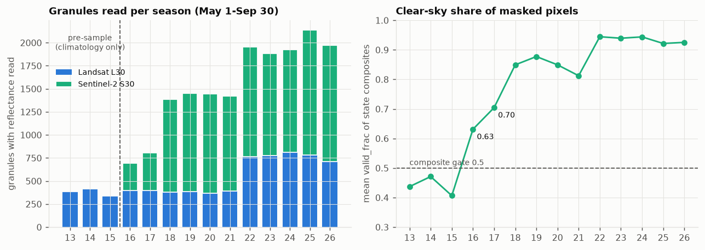
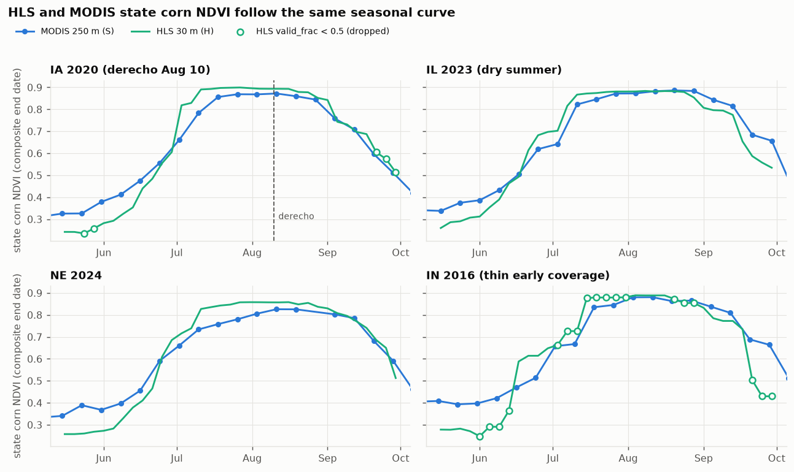
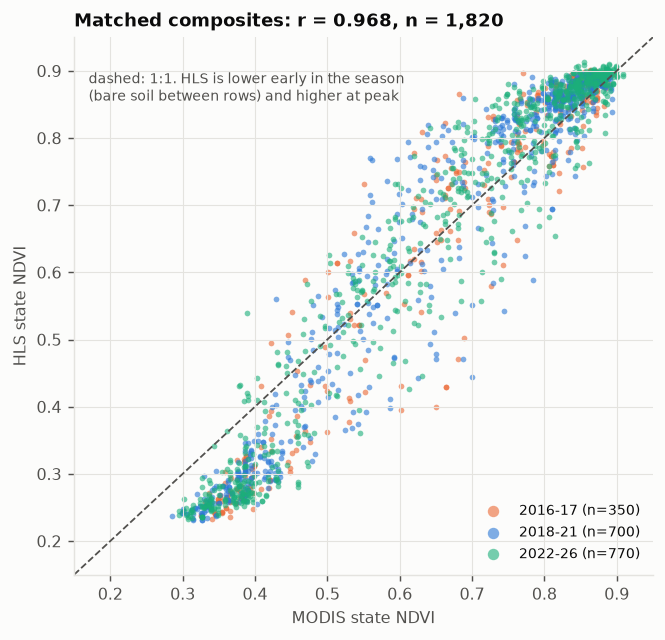
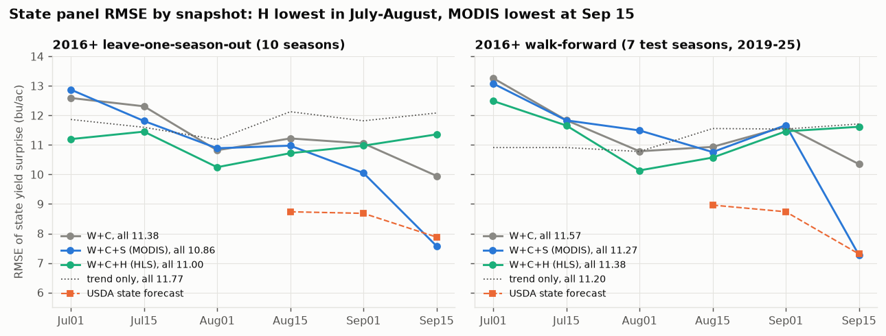
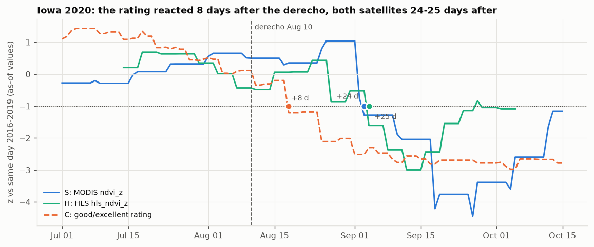

# Phase 8 results: HLS 30 m (Landsat + Sentinel-2) as a yield and price signal

Figures: `scripts/make_phase8_figures.py`. Code:
`src/cornsat/hlssample.py`, `src/cornsat/hls.py`, `src/cornsat/features.py`,
`src/cornsat/panel.py`, `src/cornsat/model.py`, `src/cornsat/backtest.py`. Tables are in
`reports/*.csv`, figures in `reports/figures/phase8_*.png`, walkthrough in
`notebooks/05_hls.ipynb`. Every number below is read from the file named above its table.

## Question

Phases 0–7 found that MODIS 250 m vegetation indices (group **S**) add nothing over weather (**W**)
and USDA crop condition (**C**) for the corn yield surprise or for trading December corn (ZCZ)
(`reports/phase6_results.md`). Two explanations were left open: 250 m pixels mix corn with
soybeans, and 16-day MODIS composites with a 14-day lag react slowly. Phase 8 asks: **does a
sharper, faster satellite signal, NASA HLS v2.0 at 30 m with a 2–3 day revisit, add yield or
price information that MODIS did not?**

## Verdict

**Negative, with one small and fragile exception.** HLS measures the same thing as MODIS, more
sharply, and that does not change the answer.

- **HLS tracks MODIS closely.** State corn NDVI from HLS and MODIS on matched composites:
  r = 0.968 (n = 1,820). HLS peaks higher (0.886 vs 0.862, purer corn pixels) and sits lower
  before canopy closure.
- **State panel (primary test, 5 states, seasons as the unit).** Adding H to W+C lowers the
  2016+ leave-one-season-out (LOSO) RMSE from 11.38 to 11.00 bu/ac (9 of 10 seasons better;
  p = 0.096 t-test, 0.037 Wilcoxon). MODIS does about the same (10.86; p = 0.099 / 0.105), and
  H vs S is a tie (p = 0.94). The H gain:
  - is not there in walk-forward (11.57 → 11.38, p = 0.33);
  - is not there from 2019 (10.61 → 10.42, p = 0.45);
  - is gone with a 14-day availability lag (p = 0.51 / 0.19);
  - would not survive any multiplicity correction.
  In the 2016+ walk-forward no model beats the trend-only forecast (11.20).
- **Timing.** In the 2020 Iowa derecho both satellites crossed −1σ 24 (MODIS) and 25 (HLS)
  days after the storm; the good/excellent rating crossed after 8 days. In the 2023 dry summer
  HLS was weaker and later than both MODIS and the rating. The faster revisit did not make
  the signal earlier.
- **National.** On 2021–2025 (n = 5 walk-forward seasons), the mean RMSE is 4.68 for W+C,
  4.53 for W+C+S and 5.69 for W+C+H. On the 2021–2026 seasons where both trade, W+C+H earns
  less than W+C+S under all three trading rules. Nothing with H beats always-short, and no
  H strategy has a P&L interval above zero.
- **Bottom line.** HLS 30 m is a valid, cleaner measurement of corn greenness. As a forecaster
  of the yield surprise it gives at most a small, fragile gain over W+C, no gain over MODIS,
  and nothing tradable.

## What changed vs MODIS

| | MODIS (group S, Phases 0–7) | HLS (group H, Phase 8) |
|---|---|---|
| Sensor | MOD13Q1/MYD13Q1 v061, Terra + Aqua | HLS v2.0: HLSL30 (Landsat 8/9) + HLSS30 (Sentinel-2A/B/C) |
| Pixel | 250 m | 30 m |
| Area | all corn pixels of a state, corn fraction from CDL | 360 fixed blocks of 256 × 256 px (7.68 km), 8 MGRS tiles × 9 blocks per state, chosen by CDL **2008–2012** corn fraction only |
| Corn mask | CDL corn fraction (release-lagged CDL year) | rotation-predicted per season from CDL Y−1..Y−3: (soy Y−1 and corn Y−2) or corn in all of Y−1..Y−3, then 1-px erosion |
| Clouds | MODIS VI QA | Fmask: cirrus, cloud, adjacent, shadow, snow, water, high aerosol rejected |
| Composite | 16-day product, 8-day stagger (Terra/Aqua) | causal 16-day trailing window ending every 4 days, May 16–Sep 29; block value = median of clear scene means; state = mask-weighted mean |
| Available | end date + 14 d | end date + 7 d (`HLS_LAG_DAYS`) |
| Climatology | 2003–2008 pre-sample + prior seasons | 2013–2015 Landsat-only pre-sample + prior seasons (min. 3) |
| Features | `ndvi_z`, `evi_anom_cum`, `ndvi_trend_anom` | `hls_ndvi_z`, `hls_evi_anom_cum`, `hls_ndvi_trend_anom` (pre-registered, same recipe) |
| History | 2009–2026 | 2016–2026 (2013–2015 for climatology only) |

Sentinel-2 uses NIR = B8A, Landsat NIR = B05. No cross-sensor offset was applied: the same-day
S30 − L30 NDVI difference over block pairs ≤ 1 day apart is −0.005 to +0.008 by season (mean;
median −0.002 to +0.004), below the 0.02 threshold set in the plan.

## Data and coverage

**Ingest** (full run, `scripts/build_hls.py`, 2 h 34 min, 0 failed granules, 499,285 HTTP
requests):
- CMR found **34,870** granules over the 38 tiles, May 1–Sep 30, 2013–2026.
- **28,162** passed the metadata cloud prefilter (scene cloud ≤ 90 %).
- 544 of those were already cached by the IA-2024 pilot, so the run processed **27,618**:
  17,839 read in full and 9,779 skipped as cloudy after reading Fmask only.
- With the pilot, the scene cache holds 18,206 read and 9,956 Fmask-only granules
  (`data/interim/hls/scenes/`).

**Output:** 1,925 state composites for 2016–2026 (`hls_state.parquet`) and 525 for the 2013–2015
pre-sample (`hls_state_presample.parquet`), 35 composite dates × 5 states per season. Composites
with `valid_frac < 0.5` (share of masked corn pixels clear) are dropped by the features.

Coverage by season (from the scene cache, `hls_state*.parquet` and `features_daily.parquet`):

| season | granules after prefilter | read L30 | read S30 | Fmask only | composites ≥ 0.5 valid (of 175) | mean valid_frac | mean blocks with data | state-days with `hls_ndvi_z` (IA/IL/IN/MN/NE) |
|---|---|---|---|---|---|---|---|---|
| 2013 | 595 | 386 | – | 209 | 73 | 0.44 | 31.4 | pre-sample |
| 2014 | 617 | 417 | – | 200 | 76 | 0.47 | 32.5 | pre-sample |
| 2015 | 546 | 338 | – | 208 | 69 | 0.41 | 28.7 | pre-sample |
| 2016 | 1,042 | 400 | 291 | 351 | 127 | 0.63 | 45.3 | 68 / 115 / **0** / 83 / 91 |
| 2017 | 1,252 | 399 | 408 | 445 | 143 | 0.70 | 50.6 | 83 / 139 / **0** / 103 / 99 |
| 2018 | 2,125 | 379 | 1,006 | 740 | 164 | 0.85 | 61.2 | 135 / 132 / 112 / 150 / 135 |
| 2019 | 2,145 | 386 | 1,062 | 697 | 172 | 0.88 | 62.9 | 151 / 143 / 120 / 151 / 143 |
| 2020 | 2,286 | 369 | 1,078 | 839 | 159 | 0.85 | 61.2 | 135 / 136 / 116 / 139 / 120 |
| 2021 | 2,425 | 394 | 1,026 | 1,005 | 157 | 0.81 | 58.7 | 147 / 142 / 123 / 138 / 147 |
| 2022 | 2,857 | 764 | 1,190 | 903 | 175 | 0.94 | 67.9 | 151 / 151 / 151 / 136 / 151 |
| 2023 | 2,947 | 774 | 1,107 | 1,066 | 174 | 0.94 | 67.7 | 147 / 147 / 151 / 143 / 147 |
| 2024 | 2,937 | 811 | 1,114 | 1,012 | 173 | 0.94 | 68.0 | 151 / 151 / 151 / 151 / 151 |
| 2025 | 3,298 | 781 | 1,355 | 1,162 | 173 | 0.92 | 66.2 | 151 each |
| 2026 | 3,090 | 713 | 1,258 | 1,119 | 171 | 0.93 | 66.7 | 147 / 151 / 136 / 147 / 151 |

- **2016–17 are thin.** Only Sentinel-2A was flying until mid-2017, and mean valid_frac was
  0.63 and 0.70. The pre-sample is thinner still (0.41–0.47; Indiana 0.28–0.33). Indiana
  therefore has fewer than 3 usable climatology seasons until 2018 and **no HLS z-score in
  2016–17**.
- **Landsat 9 from 2022.** The doubling of L30 from 2022 is Landsat 9.



**Production latency** (CMR production time − acquisition, from the item cache):
- **2016–2020** were produced 2.5–6 years after acquisition (median 935–2,089 days by year;
  the 2013–2015 pre-sample 6.6–8.7 years).
  HLS before 2022 is therefore an **archive reconstruction**, not something a trader could
  have had.
- **2021** still has a median of 108 days.
- **From 2022–23 HLS is near real time:** median 1.4–1.9 days.
- **2024–2026:** 3.3 %, 2.5 % and 5.2 % of all granules were produced more than 7 days after
  acquisition (2.3–5.9 % after the prefilter). By sensor and year it reaches 7.4 % (L30 2024)
  and 7.2 % (S30 2026).

## Sanity checks

| check | expected (plan) | result |
|---|---|---|
| HLS vs MODIS state NDVI, matched composites (nearest MODIS end date ≤ 4 d) | r > 0.8 | **r = 0.968**, n = 1,820 (2016–2026; 2025 MODIS stops Jul 11); r = 0.955–0.976 by season; mean HLS − MODIS −0.007 |
| HLS peak higher (purer pixels) | yes | mean seasonal peak over matched dates **0.886 vs 0.862**; HLS is lower early in the season (bare soil between young rows at 30 m) |
| Peak in late July | yes | HLS peak composite (valid_frac ≥ 0.5): median end-date DOY 216 (Aug 4), median obs-date DOY 208 (Jul 27) |
| Mask purity (share of predicted-corn pixels that CDL Y labels corn, ex post, 2016–2025) | ≥ 75 % | **83–94 %** by state-season, mean 89 % |
| S30 vs L30 same-day NDVI | small | −0.005 … +0.008 by season (above) |
| IA drop after 2020-08-10 derecho | yes | yes, but late: HLS z below −1 on Sep 4 (see Event timing) |
| 2023 IL/IA negative mid-season anomaly | yes | weak: `hls_ndvi_trend_anom` < −1 on Jul 10 (IA) / Jul 6 (IL); `hls_ndvi_z` min −1.01 (IA) / −0.67 (IL) |




## Independent audit (Phase 8h)

An independent review with fresh context checked the HLS pipeline for look-ahead and for fairness
of the comparisons. **No look-ahead was found** in:
- the corn masks (CDL Y−1..Y−3 only);
- the block selection (CDL 2008–2012 only, reproduced exactly);
- the composites (truncating scenes at the end date E reproduces every composite);
- the lag rule;
- the isolation of the pre-sample.

MODIS outputs are unchanged by Phase 8: the S rows of `stageA_*.csv` and `stageB_*.csv` equal
Phase 6.

Caveats raised and how they were handled (commit `c331c73`):
- **Archive reconstruction.** HLS for 2016–2021 was produced months to years after
  acquisition. *Handled:* a separate "operational" 2022+ window in the state panel, and this
  disclosure.
- **Late granules.** Some recent granules arrive more than 7 days after acquisition.
  *Handled:* a lag sensitivity run with 3, 7, 10 and 14 days (`hls_lag_sensitivity.csv`).
- **Unequal priors in event timing.** *Handled:* the event-timing z now standardises every
  group against the same prior seasons (2016..Y−1, at least 3).
- **Unequal national comparisons.** *Handled:* S and H are now compared like-for-like, with
  the same drop rule, a three-way table on common cells (`stageA_threeway.csv`) and Stage B
  on shared seasons only (`stageB_sat_shared.csv`).
- **Thin 2016–17.** *Disclosed* (coverage table; IN has no H in 2016–17); 2019+ is reported
  separately.
- **CDL vintage.** CDL is read from today's files, not the first release. *Disclosed.*
- **Multiplicity.** Many comparisons are made without correction. *Disclosed;* see below.

## State panel (primary test)

Design (`src/cornsat/panel.py`):
- **Target:** state final yield minus that state's own OLS trend over 1990..Y−1.
- **Model:** a pooled ridge over IA, IL, IN, MN and NE, one model per snapshot (Jul 1 – Sep 15),
  with alpha chosen by grouped leave-one-season-out inside the training rows.
- **Validation:** LOSO, which drops all 5 states of the held-out season, and walk-forward
  (WF) with at least 3 training seasons.
- **Strict common sample:** within a window, every set is fit and scored on identical
  (state, season, snapshot) rows complete in W, C, S and H. This excludes, for example,
  Indiana 2016–17, the 2025 snapshots after the MODIS gap (Aug 10) and 2026 (no final yield).
- **Paired tests:** d = squared error of A − squared error of B, averaged per season (the
  unit), then a t-test, a Wilcoxon test and a 95 % season-block bootstrap CI of the mean d
  (> 0 means B is better).

**RMSE, all snapshots pooled (bu/ac)**, `state_panel_accuracy.csv` (snapshot = ALL):

| window | scheme | rows | seasons scored | trend | W+C | W+C+S | W+C+H | S | H | USDA forecast¹ |
|---|---|---|---|---|---|---|---|---|---|---|
| 2016+ | LOSO | 243 | 10 (2016–2025) | 11.77 | 11.38 | **10.86** | 11.00 | 10.99 | 10.99 | 8.44 |
| 2016+ | WF | 187 | 7 (2019–2025) | 11.20 | 11.57 | 11.27 | 11.38 | **10.61** | 11.04 | 8.34 |
| 2019+ | LOSO | 187 | 7 (2019–2025) | 11.20 | 10.61 | 10.30 | 10.42 | 10.49 | **10.12** | 8.34 |
| 2019+ | WF | 104 | 4 (2022–2025) | 11.64 | 11.44 | **10.79** | 11.24 | 10.75 | 11.01 | 7.33 |
| 2022+ (operational) | LOSO² | 60 | 4 (2022–2025) | **11.00** | 12.29 | 15.18 | 11.27 | 13.06 | 14.73 | – |
| 2009+ (no H) | LOSO | 482 | 17 (2009–2025) | 17.91 | 14.85 | **13.92** | – | – | – | 8.83 |
| 2009+ (no H) | WF | 404 | 14 (2012–2025) | 18.57 | 17.76 | 16.67 | – | – | – | 8.27 |

¹ USDA state forecast − trend, only from Aug 15 and only on its own (fewer) rows; not comparable to
the model columns. ² 2022+: walk-forward is skipped (fewer than 3 test seasons). Only Jul 1, Jul 15
and Aug 1 are scored, because later snapshots have only 2022–2024 (2025 lacks S) and so fewer
than 3 training seasons.

**Paired comparisons, all snapshots pooled** (`state_panel_paired.csv`; "B better" = seasons
in which B has the lower mean squared error):

| window | scheme | A → B | seasons | RMSE A → B | B better | p (t) | p (Wilcoxon) | bootstrap 95 % CI of mean d |
|---|---|---|---|---|---|---|---|---|
| 2016+ | LOSO | W+C → W+C+S | 10 | 11.38 → 10.86 | 8 | 0.099 | 0.105 | −0.2 … 20.2 |
| 2016+ | LOSO | W+C → W+C+H | 10 | 11.38 → 11.00 | 9 | 0.096 | **0.037** | 1.8 … 22.8 |
| 2016+ | LOSO | W+C+S → W+C+H | 10 | 10.86 → 11.00 | 5 | 0.940 | 0.770 | −14.8 … 20.0 |
| 2016+ | LOSO | S → H | 10 | 10.99 → 10.99 | 7 | 0.848 | 0.770 | −15.4 … 20.3 |
| 2016+ | WF | W+C → W+C+S | 7 | 11.57 → 11.27 | 5 | 0.465 | 0.469 | −8.7 … 20.1 |
| 2016+ | WF | W+C → W+C+H | 7 | 11.57 → 11.38 | 5 | 0.328 | 0.375 | −2.5 … 10.4 |
| 2016+ | WF | W+C+S → W+C+H | 7 | 11.27 → 11.38 | 3 | 0.783 | 0.688 | −16.2 … 14.2 |
| 2016+ | WF | S → H | 7 | 10.61 → 11.04 | 3 | 0.420 | 0.688 | −27.6 … 7.0 |
| 2019+ | LOSO | W+C → W+C+S | 7 | 10.61 → 10.30 | 4 | 0.321 | 0.578 | −2.1 … 16.9 |
| 2019+ | LOSO | W+C → W+C+H | 7 | 10.61 → 10.42 | 4 | 0.448 | 0.469 | −4.6 … 11.1 |
| 2019+ | LOSO | W+C+S → W+C+H | 7 | 10.30 → 10.42 | 3 | 0.522 | 0.812 | −9.5 … 3.4 |
| 2019+ | LOSO | S → H | 7 | 10.49 → 10.12 | 6 | 0.397 | 0.219 | −7.7 … 19.4 |
| 2019+ | WF | W+C → W+C+S | 4 | 11.44 → 10.79 | 4 | 0.168 | 0.125 | 3.0 … 25.9 |
| 2019+ | WF | W+C → W+C+H | 4 | 11.44 → 11.24 | 3 | 0.292 | 0.250 | −0.03 … 10.7 |
| 2019+ | WF | W+C+S → W+C+H | 4 | 10.79 → 11.24 | 0 | 0.151 | 0.125 | −16.4 … −1.2 |
| 2022+ | LOSO | W+C → W+C+S | 4 | 12.29 → 15.18 | 1 | 0.519 | 0.625 | −298.9 … 76.9 |
| 2022+ | LOSO | W+C → W+C+H | 4 | 12.29 → 11.27 | 3 | 0.260 | 0.250 | 0.1 … 55.8 |
| 2022+ | LOSO | W+C+S → W+C+H | 4 | 15.18 → 11.27 | 3 | 0.398 | 0.625 | −21.1 … 314.7 |
| 2022+ | LOSO | trend → W+C | 4 | 11.00 → 12.29 | 2 | 0.384 | 0.625 | −88.3 … 2.7 |

- **The only nominal p < 0.05** for H over W+C is the 2016+ LOSO Wilcoxon (0.037). It is one
  of several dozen pooled and per-snapshot tests, LOSO trains on future seasons, and the
  matching walk-forward and 2019+ results are not significant.
- **2022+ is four seasons.** W+C+S at 15.18 is driven by a single Jul 15 snapshot
  (RMSE 20.6), and trend-only (11.00) is best there.

**RMSE by snapshot, 2016+** (`state_panel_accuracy.csv`):

| scheme | set | Jul01 | Jul15 | Aug01 | Aug15 | Sep01 | Sep15 |
|---|---|---|---|---|---|---|---|
| LOSO | trend | 11.86 | 11.60 | 11.18 | 12.13 | 11.82 | 12.08 |
| LOSO | W+C | 12.59 | 12.31 | 10.82 | 11.22 | 11.05 | 9.95 |
| LOSO | W+C+S | 12.87 | 11.81 | 10.89 | 10.98 | 10.05 | **7.57** |
| LOSO | W+C+H | **11.20** | **11.45** | **10.25** | **10.72** | 10.98 | 11.36 |
| LOSO | USDA | | | | 8.74 | 8.68 | 7.88 |
| WF | trend | 10.91 | 10.91 | 10.78 | 11.56 | 11.54 | 11.71 |
| WF | W+C | 13.26 | 11.84 | 10.79 | 10.93 | 11.62 | 10.35 |
| WF | W+C+S | 13.08 | 11.83 | 11.49 | 10.76 | 11.67 | **7.27** |
| WF | W+C+H | 12.49 | 11.66 | 10.14 | 10.57 | 11.46 | 11.62 |
| WF | USDA | | | | 8.96 | 8.74 | 7.31 |

- **Where each group helps.** H is lowest in July–mid-August, but per snapshot no
  W+C → W+C+H test reaches p < 0.05 in its favour (smallest: LOSO Jul 15 Wilcoxon 0.064,
  WF Aug 1 0.078). At Sep 15, H is *worse* than W+C (LOSO Wilcoxon p = 0.020, 1 of 9
  seasons better).
- **MODIS's late-season signal returns.** As in Phase 6, S is strong at Sep 15 (W+C+S 7.57
  LOSO / 7.27 WF, similar to the USDA September forecast), and H does not reproduce it.
- **By state** (2016+ LOSO, `state_panel_by_state.csv`), W+C+H is below W+C in IL, IN, MN and
  NE and above it in IA (10.28 vs 10.13). W+C+S is lower than W+C+H in IA, IL and MN.



## Event timing

Method (`state_panel_events.csv`):
- Each feature's as-of value is standardised per day of year against the **same prior
  seasons** for every group, 2016..Y−1 (at least 3).
- The table reports the first day of a **new** crossing of z ≤ −1 after the event.
- C = USDA good/excellent share (`ge`).

| event | signal | prior seasons | first z ≤ −1 after event | days after event | min z (date) |
|---|---|---|---|---|---|
| IA 2020 derecho (Aug 10) | C `ge` | 2016–2019 | Aug 18 | **8** | −3.06 (Oct 31) |
| | S `ndvi_z` | 2016–2019 | Sep 3 | 24 | −4.44 (Sep 26) |
| | H `hls_ndvi_z` | 2016–2019 | Sep 4 | 25 | −3.00 (Sep 12) |
| | S `ndvi_trend_anom` / H `hls_ndvi_trend_anom` | 2016–2019 | Sep 3 / Sep 4 | 24 / 25 | −4.70 / −5.52 |
| | S `evi_anom_cum` / H `hls_evi_anom_cum` | 2016–2019 | Oct 5 / Oct 2 | 56 / 53 | −2.73 / −1.19 |
| IA 2023 dry summer | C `ge` | 2016–2022 | Jun 21 (first crossing) | – | −2.06 (Jul 3) |
| | S `ndvi_z` | 2016–2022 | Jun 1 | – | −1.89 (Jun 22) |
| | H `hls_ndvi_z` | 2016–2022 | Sep 24 | – | −1.01 (Sep 24) |
| | H `hls_ndvi_trend_anom` | 2016–2022 | Jul 10 | – | −1.63 (Jul 14) |
| IL 2023 dry summer | C `ge` | 2016–2022 | Jun 6 | – | −3.76 (Jun 30) |
| | S `ndvi_z` | 2016–2022 | Jun 1 | – | −1.49 (Jun 6) |
| | H `hls_ndvi_z` | 2016–2022 | never | – | −0.67 (Oct 6) |
| | H `hls_ndvi_trend_anom` | 2016–2022 | Jul 6 | – | −1.17 (Jul 6) |

- **The 4-day HLS cadence did not make the derecho signal earlier.**
  - Both satellites react about 3.5 weeks after the storm, two weeks after the rating.
  - The state signal is diluted: the damage covered part of the state's corn.
  - The 16-day window and the 7-day lag add up to three weeks before a full post-event
    composite is usable.
- **In 2023 HLS was the weakest signal**, and MODIS and the rating flagged both states in
  June.
- **IA 2020 has an earlier S crossing.** S `ndvi_z` also crossed −1 on Jun 6, 2020, before
  the event, and recovered; the table counts only new crossings after Aug 10.



## Lag sensitivity

The H block is rebuilt in memory with availability = composite end + 3, 7 (main), 10 or 14 days;
W, C and S are identical across lags (`hls_lag_sensitivity.csv`, 1,000 bootstrap draws by default, all
snapshots pooled).

| lag (d) | window | scheme | seasons | RMSE W+C | W+C+S | W+C+H | W+C → W+C+H: B better | p (t) | p (Wilcoxon) |
|---|---|---|---|---|---|---|---|---|---|
| 3 | 2016+ | LOSO | 10 | 11.37 | 10.84 | 10.67 | 9 | 0.021 | 0.020 |
| 7 | 2016+ | LOSO | 10 | 11.38 | 10.86 | 11.00 | 9 | 0.096 | 0.037 |
| 10 | 2016+ | LOSO | 10 | 11.46 | 10.98 | 11.01 | 9 | 0.040 | 0.010 |
| 14 | 2016+ | LOSO | 10 | 11.35 | 10.58 | 10.99 | 7 | **0.509** | **0.193** |
| 3 | 2016+ | WF | 7 | 11.40 | 11.21 | 10.96 | 5 | 0.228 | 0.375 |
| 7 | 2016+ | WF | 7 | 11.57 | 11.27 | 11.38 | 5 | 0.328 | 0.375 |
| 10 | 2016+ | WF | 7 | 11.49 | 11.19 | 11.27 | 4 | 0.271 | 0.469 |
| 14 | 2016+ | WF | 7 | 12.02 | 10.81 | 11.12 | 6 | 0.120 | 0.156 |
| 3 / 7 / 10 / 14 | 2019+ | LOSO | 7 | 10.70 / 10.61 / 10.62 / 10.71 | 10.32 / 10.30 / 10.28 / 10.30 | 10.43 / 10.42 / 10.39 / 10.53 | 4 / 4 / 5 / 3 | 0.42 / 0.45 / 0.32 / 0.47 | 0.58 / 0.47 / 0.38 / 0.69 |
| 3 / 7 / 10 / 14 | 2022+ | LOSO | 4 | 12.29 | 15.18 | 11.49 / 11.27 / 11.45 / 13.52 | 2 / 3 / 3 / 1 | 0.27 / 0.26 / 0.29 / 0.57 | 0.63 / 0.25 / 0.38 / 0.63 |

- **The 2016+ LOSO gain depends on the lag.** It needs a lag of 10 days or less; at 14 days
  it disappears.
- **The real-time lag is not the issue before 2022.** HLS 2016–2021 is an archive
  reconstruction, so the true real-time lag there was months to years.
- **At 14 days, W+C+S beats W+C+H** in 2016+ LOSO (10.58 vs 10.99; 8 of 10 seasons favour S,
  p = 0.069 / 0.064).

## National Stage A (yield surprise, US)

Same design as Phase 6:
- **Model:** ridge on standardised features, one row per season.
- **Snapshots:** 7, Jun 15–Sep 15.
- **H sets:** walk-forward predictions start in 2021, so only **5 seasons** are scored
  (2021–2025; Aug 15–Sep 15 have 4).
- **Three-way table** (`stageA_threeway.csv`): W+C, W+C+S and W+C+H on the identical
  (season, snapshot) cells.

| scheme | snapshot | n | W+C | W+C+S | W+C+H |
|---|---|---|---|---|---|
| WF | Jun15 | 4 | 3.54 | 3.48 | 4.10 |
| WF | Jul01 | 5 | 9.32 | 9.75 | **4.47** |
| WF | Jul15 | 5 | 3.41 | **2.33** | 5.00 |
| WF | Aug01 | 5 | 3.36 | **2.62** | 7.81 |
| WF | Aug15 | 4 | **2.68** | 3.97 | 7.43 |
| WF | Sep01 | 4 | 2.85 | **2.01** | 2.27 |
| WF | Sep15 | 4 | 3.87 | **1.55** | 5.47 |
| WF | **ALL** | 5 (2021–2025) | 4.68 | **4.53** | 5.69 |
| LOSO | **ALL** | 10 (2016–2025) | **5.90** | 5.97 | 6.87 |

- **Walk-forward, W+C → W+C+H:** worse, 2 of 5 seasons better (p = 0.45 t / 0.44 Wilcoxon).
- **Walk-forward, W+C+S → W+C+H:** H better in 1 of 5 seasons (p = 0.35 / 0.44).
- **One nominal significance, and it is in the wrong direction:** Jun 15 W+C → W+C+H,
  p = 0.024 t, H worse in 4/4.
- **H alone vs S alone** (`stageA_paired.csv`, WF, 2021–2025): RMSE 4.16 → 3.01, 5 of 5
  seasons, p = 0.068 / 0.063. These are single-group models on 5 seasons, and the combined
  sets point the other way.

## National Stage B (ZCZ trading)

Same rules and costs as Phase 6 (1 contract, weekly Jun–Sep, $15 per side). Full 2014–2026
results for the H strategies (`stageB_summary.csv`):

| strategy | net P&L $ | Sharpe | seasons + | trades | P&L 95 % CI |
|---|---|---|---|---|---|
| always_short (benchmark) | 24,035 | 0.93 | 10 / 13 | 26 | 7,885 … 40,873 |
| change\|H | 4,075 | 0.33 | 4 / 13 | 52 | −2,075 … 10,753 |
| vs_usda\|H | −845 | −0.02 | 2 / 13 | 18 | −5,098 … 3,205 |
| level\|H | −1,623 | −0.17 | 1 / 13 | 32 | −5,795 … 3,103 |
| vs_usda\|W+C+H | −5,715 | −0.51 | 4 / 13 | 43 | −12,720 … 455 |
| change\|W+C+H | −8,918 | −0.43 | 4 / 13 | 126 | −19,488 … 1,603 |
| level\|W+C+H | −11,528 | −0.59 | 4 / 13 | 89 | −33,550 … 4,365 |

H strategies hold no positions before 2021, and W+C+H equals W+C in 2014–2020 (fallback), so
the meaningful comparison is on the **shared seasons 2021–2026** (`stageB_sat_shared.csv`,
P&L in $):

| rule | W+C | W+C+S | W+C+H | S | H | W+C+H − W+C+S | 95 % CI | seasons H better / S better |
|---|---|---|---|---|---|---|---|---|
| level | −5,075 | −1,683 | −14,378 | −148 | −1,623 | **−12,695** | −20,708 … −6,625 | 0 / 6 |
| change | −10,998 | −688 | −3,883 | −1,585 | 4,075 | −3,195 | −12,855 … 6,465 | 2 / 4 |
| vs_usda | 4,730 | 3,583 | −1,735 | −3,053 | −845 | −5,318 | −20,048 … 5,093 | 3 / 2 |

- **W+C+H earns less than W+C+S under all three rules.** For `level` the gap is
  significant: 0 of 6 seasons favour H.
- **Against the same rule without a satellite** (`stageB_satellite.csv`, full period),
  W+C+H loses $9,303 with `level` (CI −16,960 … −3,068) and $6,465 with `vs_usda`. With
  `change` it gains $7,115 (CI −5,390 … 19,910), which is a loss of −16,033 made smaller.
- **`change|H`** (+4,075 over 6 active seasons) is the best H strategy; its CI includes 0,
  and its random-sign p is 0.27.
- **No H strategy comes close to always-short.**

## Disclosures and limitations

- **Pre-registered features, exploratory evaluation.** The H group, the lag and the windows
  were fixed in the plan before the HLS data were ingested. The 2022+ window, the lag
  sensitivity and the like-for-like national tables were added after the audit, with results
  in view.
- **Multiple comparisons.**
  - The state panel alone has 4 windows × 2 schemes × 11 pairs × 7 snapshot levels.
  - The lag sensitivity, events, Stage A pairs and Stage B add more.
  - The one result that favours H (2016+ LOSO Wilcoxon 0.037) would not survive any
    correction, and none of the per-snapshot W+C → W+C+H tests reaches 0.05 in its favour.
    Against W+C+S, two per-snapshot tests favour H nominally (2019+ LOSO Aug 15,
    p = 0.034 / 0.031; 2019+ WF Jul 15, t-test p = 0.033), and two favour S
    (2016+ Sep 15, LOSO p = 0.026 / 0.039 and WF p = 0.028 / 0.031).
- **Archive reconstruction.** HLS 2016–2021 was produced 0.3–6 years after acquisition (median by season). For
  those seasons the 7-day lag is a modelling assumption, not history. The 2022+ operational
  window has only 4 seasons.
- **Late granules.** 2–6 % of recent granules (up to 7 % for one sensor-year) are produced
  more than 7 days after acquisition. The 14-day lag run removes the H gain.
- **Thin early seasons.**
  - 2016–17 valid_frac is 0.63–0.70, and the pre-sample is 0.41–0.47.
  - Indiana has no H in 2016–17, so the strict common sample drops it there for every set.
  - Early climatologies rest on 3–5 seasons.
- **Sample, not census.** 360 blocks (8 tiles × 9 per state) cover a fraction of each state's
  corn and were chosen for high 2008–2012 corn share. They may not represent the state yield
  as well as a full MODIS state mean.
- **CDL vintage.** Masks are built from today's CDL files, not the first release.
  Look-ahead-safe by year (Y−1..Y−3), but later CDL revisions are used.
- **No cross-sensor correction.** S30 − L30 differences are small (≤ 0.008 in season means),
  and an option exists (`--bias-correction`) but is off.
- **Small samples everywhere.** The state panel has 10 seasons in 2016+, 7 in walk-forward
  and 4 in 2022+. National walk-forward has 5. The power to detect a gain of about 0.5 bu/ac
  is low, and LOSO trains on future seasons.
- **MODIS 2025 gap.** S is missing after Aug 10, 2025, which removes those snapshots from
  every strict common sample.

## How to reproduce

```bash
uv sync
# HLS sample blocks and season corn masks (CDL from Planetary Computer; cached)
uv run python scripts/build_hls_sample.py
# HLS ingest: needs EARTHDATA_TOKEN in .env; ~2.5 h cold, resumable; writes hls_state*.parquet
uv run python scripts/build_hls.py
uv run python scripts/build_hls.py --combine-only      # composites from the scene cache only
# or the whole pipeline (steps: prices cornmask modis hls_sample hls weather usda features backtest)
uv run python scripts/build_all.py --from features      # features + national backtest from caches
uv run python scripts/run_state_panel.py                # reports/state_panel_*.csv
uv run python scripts/hls_lag_sensitivity.py            # reports/hls_lag_sensitivity.csv (in memory)
uv run python scripts/run_backtest.py                   # reports/stageA_*.csv, stageB_*.csv
uv run pytest -q
```

Figures in `reports/figures/phase8_*.png` and the notebook `notebooks/05_hls.ipynb` read only the
saved parquet files and CSVs.
